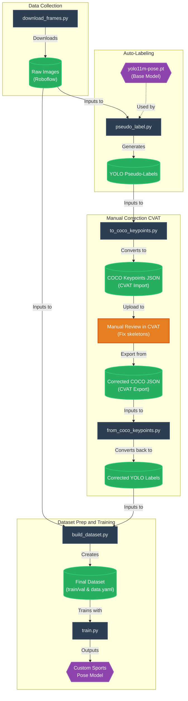
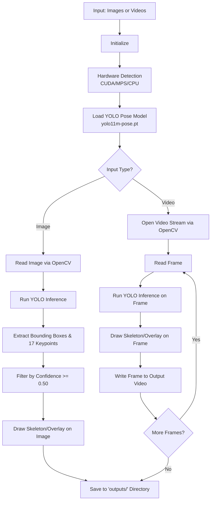

# AI Basketball Practice Coach

A YOLO-based system for pose-driven biomechanical analysis of basketball shooting technique, turning raw practice video into measurable technique insights and spoken, LLM-generated feedback.

Basketball shooting analysis has traditionally relied on manual video review, making consistent, quantitative technique assessment difficult. This project extracts human pose data from basketball practice footage and converts body-joint keypoints into sport-specific technique metrics.

A camera on a tripod watches one player practising. The app tracks their pose and the ball,
detects shots, makes/misses, dribbles and layups, measures shooting form, and:

1. **Live mode** – speaks one short coaching cue after each shot (ElevenLabs voice, phrased by Claude).
2. **Analytics mode** – after the session, a dashboard shows makes, form trends, consistency,
   per-shot key frames and a written session summary.

Pose comes from **Ultralytics YOLO11 pose** (17 COCO keypoints), hands from **MediaPipe** (21 landmarks
per hand, used around the release), and the ball from a YOLO detector trained on basketball frames.

> Status: the full pipeline is implemented and tested on synthetic shots and recorded webcam footage.
> Thresholds and target ranges are starting values and still need tuning on real practice footage
> (see the [plan](docs/Basketball_Coach_Project_Plan.pdf) and the [status report](docs/Basketball_Coach_Status_Report.pdf)).

---

## Team

**B.Tech CSE, VIT Chennai**

| Name | Registration No. |
| :--- | :--- |
| Prodhosh VS | 25BCE5129 |
| Gowreesh V T | 25BCE1760 |
| Sri Saidhakshini | 25BCE1685 |

**Under the guidance of:** Saraswathi D, Associate Professor, SCOPE

---

## Challenges & Research Gap

Existing studies demonstrate the feasibility of pose-based basketball analysis, but robust end-to-end technique assessment remains an open problem:

- **Key Challenges**
  - Reliable keypoint detection across varying camera angles, lighting, and motion blur.
  - Distinguishing meaningful technique deviations from normal differences between players.
- **Research Gap**
  - Limited availability of basketball-specific annotated pose data for shooting analysis.

---

## Project Objectives

Build an end-to-end system that captures basketball shooting footage, extracts pose data, quantifies shooting technique, and delivers actionable, interpretable feedback to the player — closing the gap between raw pose estimation and coach-quality analysis.

---

## Methodology & System Architecture

The "Diagnosis Engine" pipeline has five stages, each now implemented:

1. **Video Processing** – capture and record practice footage with OpenCV (`live.py`, `analyze.py`).
2. **Pose Estimation** – 17 body keypoints with YOLO-Pose, the practising player locked and smoothed
   (`coach/tracking.py`), plus ball detection (`coach/ball.py`) and hand landmarks (`coach/hands.py`).
3. **Feature Extraction & Analysis** – shot / make-miss / dribble / layup events and biomechanical
   metrics, compared against target ranges (`coach/events.py`, `coach/metrics.py`, `coach/coaching.py`).
4. **AI Insight Generation** – Claude turns the chosen correction into a short cue and writes session
   summaries (`coach/llm.py`).
5. **Interactive Feedback** – ElevenLabs voice during practice (`coach/voice.py`) and a web dashboard
   afterwards (`dashboard.py`).

---

## Setup

```bash
git clone https://github.com/Innovative-Design-Project/pose-estimation.git
cd pose-estimation
python3 -m venv .venv
source .venv/bin/activate        # Windows: .venv\Scripts\activate
pip install -r requirements.txt
```

Optional keys in `.env` (everything still works without them, with fallbacks):

```
ANTHROPIC_API_KEY=...        # Claude phrases cues and writes summaries (else: rule text)
ELEVENLABS_API_KEY=...       # spoken cues (else: macOS `say`, or printed)
ELEVENLABS_VOICE_ID=...      # optional, defaults to a premade voice
COACH_LLM_MODEL=...          # optional, defaults to claude-opus-5-5
```

On macOS, allow camera access for your terminal in System Settings → Privacy & Security → Camera.

### Ball detector

Ball tracking (make/miss, shot arc, dribbles) needs trained weights:

```bash
python sports_pipeline/train_ball.py --device mps        # ~10 min/epoch on an M4
```

Weights land in `sports_pipeline/runs/ball_detector/weights/best.pt`, which `live.py` and `analyze.py`
pick up automatically. Without them, shots are still detected from pose alone (no make/miss or arc).

---

## Camera setup

- Tripod at the **side or 45°**, on the **shooting-hand side**, about 4–6 m away.
- The **whole body and the rim** in frame. 60 fps if the camera supports it (a phone via Continuity Camera).
- Keep the camera still for the whole session – the rim is marked once at the start.

---

## Live mode

```bash
python live.py                                   # default camera; drag a box around the rim, Enter
python live.py --list-cameras                    # find the phone camera index
python live.py --source 1 --cam-fps 60 --hoop last --shooting-hand left
python live.py --voice say --no-llm              # offline voice and wording
python live.py --no-coach                        # pose + recording only
```

Press `q`/`Esc` to stop. Each run writes `sessions/<timestamp>/` (`raw.mp4`, `frame_times.csv`,
`keypoints.jsonl`, `hoop.json`, `meta.json`, `shots/*.jpg`) and adds the session to `sessions/coach.db`.

## Post-session analysis and dashboard

```bash
python analyze.py sessions/20261022-103747       # re-analyse with the accurate pose model
python analyze.py videos/practice.mp4 --hoop calibrate --summary
streamlit run dashboard.py
```

The dashboard has: session KPIs, shot timeline and rolling FG%, a shot list with set point / release /
follow-through frames, metric trends against target bands, consistency, dribbling, session comparison,
CSV export and a Claude-written summary.

---

## What is measured

| Activity | Metrics |
| :--- | :--- |
| Shooting | elbow angle at set point, arm extension at release, knee bend, release height, jump height, release timing vs jump peak, follow-through hold, body lean, landing drift, launch angle, wrist snap (hands) |
| Make/miss | ball crossing the rim plane inside the marked rim; FG%, streaks |
| Dribbling | count, pace, dribble height, hand used |
| Layups | steps before take-off, take-off foot vs finishing hand |

Angles are 2D, from one camera position. Target ranges live in `coach/coaching.py` (`TARGETS`) and
should be tuned with a coach.

---

## Project structure

```
coach/                  # the coaching library
  geometry.py           #   keypoint indices, angles, FrameState
  tracking.py           #   player lock + One-Euro keypoint smoothing
  ball.py               #   ball detector wrapper + tracker
  hoop.py               #   rim box + calibration
  hands.py              #   MediaPipe hand landmarks on wrist crops, wrist snap
  events.py             #   shot / make-miss / dribble / foot-plant detection
  metrics.py            #   per-shot form metrics
  coaching.py           #   target ranges and cue selection
  llm.py                #   Claude cue phrasing and session summaries
  voice.py              #   ElevenLabs streaming TTS + fallbacks
  store.py              #   SQLite session store
  engine.py             #   per-frame glue used by live.py and analyze.py
live.py                 # live camera mode
analyze.py              # offline analysis of a session or video
dashboard.py            # Streamlit analytics dashboard
main.py                 # batch pose estimation on images/ and videos/
sports_pipeline/        # data, labelling, pose fine-tuning, evaluation, ball detector training
tests/                  # unit tests with a synthetic shooter (pytest)
```

## Data pipeline (sports_pipeline/)

Beyond off-the-shelf inference, [`sports_pipeline/`](sports_pipeline) contains the data pipeline used to fine-tune a custom, sports-specific pose model — from raw frame collection through pseudo-labeling, manual correction in CVAT, and final dataset assembly/training:



### Batch inference (`main.py`)



## Tests

```bash
pytest tests
```

## Measured speed (Apple M4, 720p, pose only)

| Model | Device | Latency / frame | Use |
| :--- | :--- | :--- | :--- |
| `yolo11n-pose` | MPS | 22 ms (~45 fps) | Live mode (default for `live.py`) |
| `yolo11m-pose` | MPS | 52 ms (~19 fps) | Offline analysis (default for `analyze.py`, `main.py`) |

The coaching engine adds ~1 ms per frame, ~11 ms while hand landmarks run around a shot.
On a 30 fps webcam recording, live mode analyses ~95% of frames (~28 fps) with pose + ball detection.

## Roadmap

- [x] Core pose estimation pipeline (image & video, 17 COCO keypoints)
- [x] Custom sports dataset collection, pseudo-labeling & CVAT correction pipeline
- [x] Clip-level train/val/test split and pose evaluation script
- [x] Live camera mode with session recording
- [x] Ball detector, rim calibration, hand landmarks
- [x] Shot, make/miss, dribble and layup detection; shooting form metrics
- [x] LLM-based feedback (Claude) and voice feedback (ElevenLabs) – built; untested until API keys are added
- [x] Post-session analytics dashboard
- [ ] Record practice footage and validate detection accuracy
- [ ] Tune thresholds and target ranges with a coach
- [ ] Hand-label the test set and measure pose accuracy (CVAT)

---

## License

MIT
